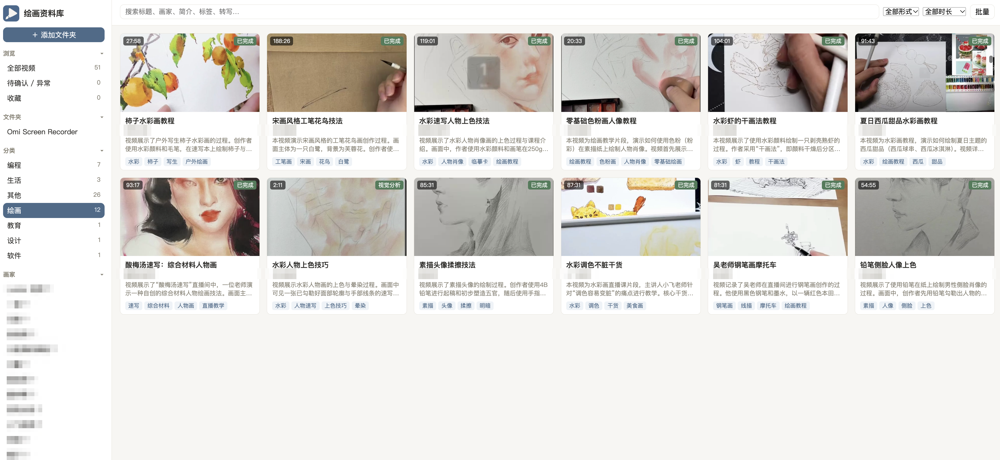

# VideoShelf

**English** | [简体中文](README.zh-CN.md)

VideoShelf is a local-first video library for managing, searching, and organizing your video collection — built around painting-tutorial videos, but works for courses, vlogs, and any local media. It ships with a browser-based library app and a command-line video analysis tool. All AI inference can run entirely on your own machines.



## Features

### Video Library (browser app)

- **Multi-folder library**: recursive import of MP4/MKV/MOV, full SHA-256 deduplication, content separated from file paths (moving files or re-importing re-links automatically)
- **Joint audio + vision analysis**: Chinese transcription plus key-frame visual analysis via a local OpenAI-compatible inference service (oMLX, Ollama, or any LiteLLM-fronted backend) — generates title suggestions, summaries, category/topic/format, tags, and artist candidates with roles and evidence, plus 1–2 representative screenshots that jump to the playback position
- **Graceful fallback**: videos without usable speech (or when the ASR service is down) fall back to vision-only analysis with the status recorded explicitly
- **AI vs. human values kept separate**: re-analyzing never overwrites your manual edits
- **Chinese full-text search** (FTS5 trigram) across titles, artists and aliases, summaries, tags, and transcripts
- **In-browser playback**: MP4 served directly, MOV/MKV remuxed/transcoded on the fly; jump-to-timestamp screenshots; reveal file in Finder
- **Curation tools**: favorites, virtual collections, notes, bulk edit, a "needs review" queue, task progress with retry
- **Backup & restore**: library database plus screenshots (never your videos), with cross-machine root rebinding

### CLI Video Analyzer

- **Automatic scanning**: discover videos in a directory (MP4, AVI, MOV, MKV, WebM)
- **Smart frame extraction**: interval, fixed-count, or scene-detection strategies
- **AI classification**: two-stage classification with a local vision model
- **Tag generation**: structured tags from a configurable YAML taxonomy
- **Export formats**: JSON, CSV, SQLite with incremental updates

## Getting Started

### Prerequisites

- Python 3.10+
- ffmpeg on your PATH
- An OpenAI-compatible inference endpoint with a vision model and (optionally) an ASR model — e.g. [oMLX](https://github.com/KipData/omlx) on macOS, Ollama, or a LiteLLM proxy in front of either

### Install

```bash
git clone https://github.com/GlennZhang/VideoShelf.git
cd VideoShelf
python -m venv .venv && source .venv/bin/activate
pip install -r requirements.txt
```

### Run the library app

```bash
# 1. Environment check (ffmpeg, FTS5, inference service connectivity + models)
python -m src.cli library doctor

# 2. Start the local web app (default: http://127.0.0.1:8900)
python -m src.cli library serve

# 3. Open in your browser, click "Add Folder" — scanning and analysis queue up automatically
```

### Use the CLI analyzer

```bash
python src/cli.py parse /path/to/videos                  # analyze and tag
python src/cli.py scan /path/to/videos --recursive       # scan only
python src/cli.py parse /path/to/videos -f csv -o out.csv
python src/cli.py stats results.json                    # tag statistics
```

## Configuration

- **`config.yaml`** — model settings, frame-extraction strategy, classification thresholds, output format, logging
- **`tags_config.yaml`** — the tag taxonomy (hierarchical categories, predefined tags, free-text rules)
- **`omlx:` section of `config.yaml`** — inference endpoint URL, API key, and model names. Environment variables override the file so secrets never need to be committed:

```bash
export OMLX_BASE_URL="https://your-litellm.example.com/v1"
export OMLX_API_KEY="sk-..."                       # keep out of git
export OMLX_VISION_MODEL="your-vision-model"
export OMLX_ASR_MODEL="your-asr-model"
```

Thinking mode is disabled automatically for both oMLX (`chat_template_kwargs`) and Ollama/LiteLLM (`think`) backends, and transcripts from Ollama-served Qwen3-ASR are cleaned of their `language ...<asr_text>` wrapper — no per-backend configuration needed.

### Backup & restore

```bash
python -m src.cli library backup                     # writes library-backup-*.zip
python -m src.cli library restore backup.zip         # restore into current data dir
python -m src.cli library restore backup.zip \
    --old-root /Volumes/old --new-root /Volumes/new # rebind after moving machines
```

## Video summaries

Open `/static/summaries.html`, point it at a local tutorial video (MP4/MKV/MOV), and the pipeline transcribes the full audio, samples keyframes evenly (optional — untick to summarize from the transcript alone), and produces two artifacts: **study notes** with chapter structure and precise timestamps, plus a **polished rewrite** of the content. Clicking a timestamp or screenshot jumps to the playback position.

Long videos (transcripts over 200k characters) are summarized in resumable chunks: the rewrite is stitched from per-chunk caches (8k characters each), and notes go through a two-stage draft + merge pass. Failed tasks can be retried and reuse completed caches. ASR and vision models come from the model settings page.

## Bilibili download

Open `/static/downloads.html` and paste a Bilibili link — a single BV, a multi-part video, or a collection page (with pagination). Items queue up and download one by one via yt-dlp. Failed downloads keep everything already completed; retrying skips finished items.

Three login options: read the browser's existing Bilibili session (default, recommended; macOS asks for keychain authorization once), paste SESSDATA manually, or stay logged out (quality is then limited). **QR login** shows a code to scan with the mobile app — the cookie is saved automatically and never displayed. Quality preference and the default download directory are configurable. Every downloaded item offers a one-click **generate summary** that chains into the video summaries page.

## Illustrated course tutorials

Open **课程教程** in the library sidebar to import a local course folder, track per-lesson processing, review source-linked steps and screenshots, and download portable Markdown + images as ZIP. Alternatively enqueue with `python -m src.cli library course "/path/to/course"`, then start `library serve`.

Course processing transcribes the full audio (or reads same-name SRT/VTT), uses its own resumable caches under `data/courses/`, and leaves library sampling behavior unchanged. ASR timing is approximate at 30-second chunk granularity. Model outputs require review. Topic documents collect lesson excerpts with sources; they do not reconcile conflicting instructions. The existing library backup does not include courses: back up `data/courses/` separately or download the ZIP. See the [Chinese README](README.zh-CN.md) for the full workflow and limitations.

## Course Markdown reading and editing

Course documents offer **Reading**, inline **Live editing**, and **Source** modes over the same saved Markdown. Autosave, Cmd/Ctrl+S, undo, recoverable browser drafts, stale-write protection, and explicit AI-draft comparison keep manual edits separate from inference caches. Routine recognition diagnostics are hidden from prose; actionable reviews and video evidence are available in a side panel.

Working documents live in each course's `documents/`, latest AI drafts in `generated/`, and original model evidence in `cache/`. ZIP export uses the working documents. **Regenerate AI draft** reuses ASR but never replaces existing working Markdown without adoption. Existing courses migrate without inference; previous exports are retained in `pre-editor-export/`.

The browser bundle is included and works without a CDN. To develop it with Node 24: `npm --prefix frontend ci`, `npm --prefix frontend run build`, and `npm --prefix frontend test`. Third-party notices are in `frontend/THIRD_PARTY_NOTICES.txt`.

## Course model settings and failure recovery

Open `/static/model-settings.html` to configure course organization, screenshot recognition, and speech transcription separately — LiteLLM gateway base URL, API key, and model name, with a model-list round-trip to test the connection. Settings take effect from the next lesson. Keys are never echoed back and are stored in a private file with 0600 permissions in the data directory; leaving a field blank keeps the existing key, and changing the address does not carry the old key over.

Course organization repairs unescaped quotes inside complete JSON; genuinely incomplete responses get limited retries, and fragments that still fail keep their raw transcript and enter the review area. Quotes that cannot be matched verbatim are reviewed separately without blocking other knowledge points. Completed single-lesson documents open immediately, without waiting for the whole course to finish. Manual edits are always preserved; regenerated AI drafts require explicit adoption.

## Short-drama breakdown

Open `/static/dramas.html` to import a local video or folder. The pipeline detects cuts, samples chronological frames, transcribes audio (or reads sidecar subtitles), analyzes each shot, and exports illustrated Markdown with character/scene cards and image/video reconstruction prompts. Long-take analysis subdivisions are labeled separately from editorial cuts.

Four analysis backends are available (default `rea-toon`). The `rea-toon` and `rea-video` backends are external CLIs, not Python dependencies of this project — install them from GitHub and they will be found on PATH (custom paths, VLM endpoint, key and model are configurable in the settings page; local endpoints bypass the proxy):

```bash
pip install git+https://github.com/JuneYaooo/rea-toon.git
pip install git+https://github.com/JuneYaooo/rea-video.git
```

Alternatively choose the sandboxed `agy` CLI with a process-scoped HTTPS proxy, or the existing compatible vision profile (including LiteLLM). ASR uses the existing audio profile for every backend. Working Markdown supports reading/live/source modes; regeneration offers a separate draft and preserves edits and assets. ZIP exports saved working copies. Data lives in `<library.data_dir>/dramas/` and should be backed up separately. Prompts are reconstruction suggestions, not recovered originals. See the [Chinese README](README.zh-CN.md) for configuration and timing limitations.

## Privacy

The library is local-first: analysis runs against your own inference services, and runtime data (database, transcripts, screenshots, audio caches in `data/`, audit reports in `artifacts/`) never leaves your machine and is excluded from git. If you point `OMLX_BASE_URL` at a remote service, sampled frames and audio are sent there — that is the only outbound transfer.

## Project Structure

```
VideoShelf/
├── src/
│   ├── library/            # video library app (API, pipeline, scanner, web UI)
│   ├── video_parser/       # CLI analyzer core
│   ├── config/             # configuration management
│   └── cli.py              # CLI entry points
├── tests/                  # test suite
├── config.yaml             # app configuration
├── tags_config.yaml        # tag taxonomy
└── requirements.txt
```

## Development

```bash
python -m pytest tests/library/ -q   # library tests
python -m pytest tests/ -q           # everything
black src/ tests/ && flake8 src/ tests/
```

## License

MIT — see [LICENSE](LICENSE).
