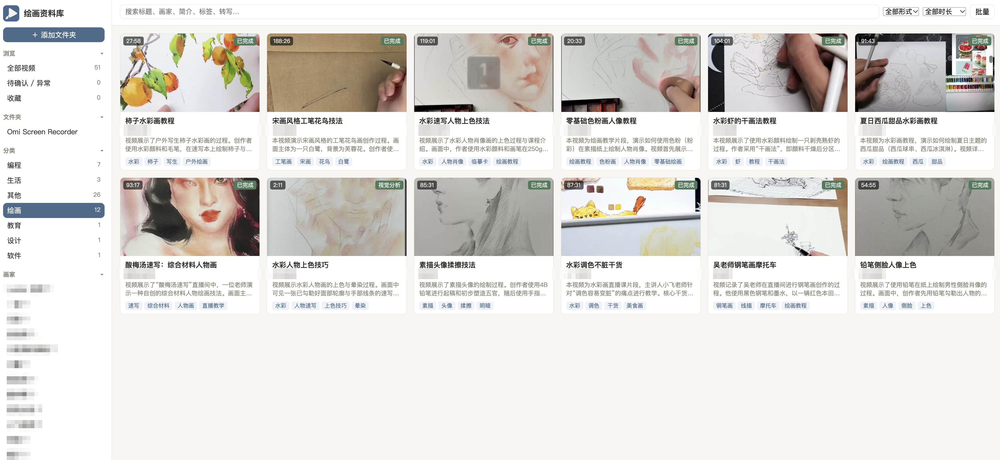

# VideoShelf

**English** | [简体中文](README.zh-CN.md)

VideoShelf is a local-first video library for managing, searching, and organizing your video collection — built around painting-tutorial videos, but works for courses, vlogs, and any local media. It ships with a browser-based library app and a command-line video analysis tool. All AI inference can run entirely on your own machines.



## Features

### Video Library (browser app)

- **Multi-folder library**: recursive import of MP4/MKV/MOV, full SHA-256 deduplication, content separated from file paths (moving files or re-importing re-links automatically)
- **Joint audio + vision analysis**: Chinese transcription plus key-frame visual analysis via a local OpenAI-compatible inference service (oMLX, Ollama, or any LiteLLM-fronted backend) — generates title suggestions, summaries, category/topic/format, tags, and artist candidates with roles and evidence, plus 1–2 representative screenshots that jump to the playback position
- **Graceful fallback**: videos without usable speech (or when the ASR service is down) fall back to vision-only analysis with the status recorded explicitly
- **AI vs. human values kept separate**: re-analyzing never overwrites your manual edits
- **Chinese full-text search** (FTS5 trigram) across titles, artists and aliases, summaries, tags, and transcripts
- **In-browser playback**: MP4 served directly, MOV/MKV remuxed/transcoded on the fly; jump-to-timestamp screenshots; reveal file in Finder
- **Curation tools**: favorites, virtual collections, notes, bulk edit, a "needs review" queue, task progress with retry
- **Backup & restore**: library database plus screenshots (never your videos), with cross-machine root rebinding

### CLI Video Analyzer

- **Automatic scanning**: discover videos in a directory (MP4, AVI, MOV, MKV, WebM)
- **Smart frame extraction**: interval, fixed-count, or scene-detection strategies
- **AI classification**: two-stage classification with a local vision model
- **Tag generation**: structured tags from a configurable YAML taxonomy
- **Export formats**: JSON, CSV, SQLite with incremental updates

## Getting Started

### Prerequisites

- Python 3.10+
- ffmpeg on your PATH
- An OpenAI-compatible inference endpoint with a vision model and (optionally) an ASR model — e.g. [oMLX](https://github.com/KipData/omlx) on macOS, Ollama, or a LiteLLM proxy in front of either

### Install

```bash
git clone https://github.com/GlennZhang/VideoShelf.git
cd VideoShelf
python -m venv .venv && source .venv/bin/activate
pip install -r requirements.txt
```

### Run the library app

```bash
# 1. Environment check (ffmpeg, FTS5, inference service connectivity + models)
python -m src.cli library doctor

# 2. Start the local web app (default: http://127.0.0.1:8900)
python -m src.cli library serve

# 3. Open in your browser, click "Add Folder" — scanning and analysis queue up automatically
```

### Use the CLI analyzer

```bash
python src/cli.py parse /path/to/videos                  # analyze and tag
python src/cli.py scan /path/to/videos --recursive       # scan only
python src/cli.py parse /path/to/videos -f csv -o out.csv
python src/cli.py stats results.json                    # tag statistics
```

## Configuration

- **`config.yaml`** — model settings, frame-extraction strategy, classification thresholds, output format, logging
- **`tags_config.yaml`** — the tag taxonomy (hierarchical categories, predefined tags, free-text rules)
- **`omlx:` section of `config.yaml`** — inference endpoint URL, API key, and model names. Environment variables override the file so secrets never need to be committed:

```bash
export OMLX_BASE_URL="https://your-litellm.example.com/v1"
export OMLX_API_KEY="sk-..."                       # keep out of git
export OMLX_VISION_MODEL="your-vision-model"
export OMLX_ASR_MODEL="your-asr-model"
```

Thinking mode is disabled automatically for both oMLX (`chat_template_kwargs`) and Ollama/LiteLLM (`think`) backends, and transcripts from Ollama-served Qwen3-ASR are cleaned of their `language ...<asr_text>` wrapper — no per-backend configuration needed.

### Backup & restore

```bash
python -m src.cli library backup                     # writes library-backup-*.zip
python -m src.cli library restore backup.zip         # restore into current data dir
python -m src.cli library restore backup.zip \
    --old-root /Volumes/old --new-root /Volumes/new # rebind after moving machines
```

## Privacy

The library is local-first: analysis runs against your own inference services, and runtime data (database, transcripts, screenshots, audio caches in `data/`, audit reports in `artifacts/`) never leaves your machine and is excluded from git. If you point `OMLX_BASE_URL` at a remote service, sampled frames and audio are sent there — that is the only outbound transfer.

## Project Structure

```
VideoShelf/
├── src/
│   ├── library/            # video library app (API, pipeline, scanner, web UI)
│   ├── video_parser/       # CLI analyzer core
│   ├── config/             # configuration management
│   └── cli.py              # CLI entry points
├── tests/                  # test suite
├── config.yaml             # app configuration
├── tags_config.yaml        # tag taxonomy
└── requirements.txt
```

## Development

```bash
python -m pytest tests/library/ -q   # library tests
python -m pytest tests/ -q           # everything
black src/ tests/ && flake8 src/ tests/
```

## License

MIT — see [LICENSE](LICENSE).
