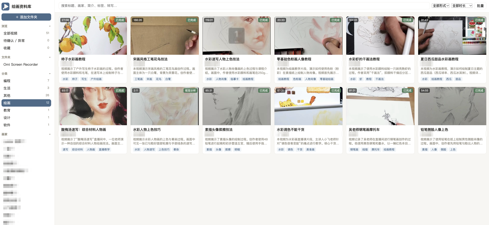

[English](README.md) | **简体中文**

# VideoShelf（本地视频资料库）

VideoShelf 用于管理、搜索和整理本地视频，适用于绘画教学、课程、Vlog 等不同类型的视频。绘画是当前重点使用场景，分类和画家信息也可按需使用。项目同时提供浏览器资料库和命令行视频分析工具。



## 功能特性

- **本地视频资料库**：索引多个文件夹，浏览、搜索、收藏和整理视频
- **自动视频扫描**：从目录中发现视频文件（MP4、AVI、MOV、MKV、WebM）
- **智能帧提取**：使用多种策略提取具有代表性的关键帧
- **AI 智能分类**：基于本地 qwen3-VL:8B 模型的两阶段分类
- **标签生成**：基于可配置的 YAML 标签体系生成结构化标签
- **多种导出格式**：JSON、CSV、SQLite，支持增量更新
- **本地优先**：默认使用本机 Ollama/oMLX 服务；若配置远端 oMLX，媒体分析内容会发送到该服务

## 安装

### 前置要求

- Python 3.10 或更高版本
- 已安装 Ollama 及 qwen3-VL 模型

### 安装步骤

1. 克隆仓库：
```bash
git clone <repository-url>
cd VideoShelf
```

2. 创建虚拟环境：
```bash
python -m venv venv
source venv/bin/activate  # Windows 下使用: venv\Scripts\activate
```

3. 安装依赖：
```bash
pip install -r requirements.txt
```

4. 拉取 Ollama 模型：
```bash
ollama pull qwen3-vl:8b
```

## 使用方法

### 基本用法

解析目录中的所有视频：
```bash
python src/cli.py parse /path/to/videos
```

### 命令

- `parse` - 处理视频并生成标签
- `scan` - 仅扫描目录中的视频，不做处理
- `stats` - 显示标签统计信息
- `tags` - 管理标签配置

### 选项

- `--output, -o` - 输出文件路径
- `--format, -f` - 输出格式（json、csv、sqlite）
- `--recursive, -r` - 递归扫描目录
- `--force` - 重新处理已处理过的视频
- `--config` - 自定义配置文件路径

### 示例

以指定格式解析并输出：
```bash
python src/cli.py parse /path/to/videos --format csv --output results.csv
```

仅扫描不处理：
```bash
python src/cli.py scan /path/to/videos --recursive
```

查看统计信息：
```bash
python src/cli.py stats results.json
```

## 配置

### 应用配置（config.yaml）

主要应用设置，包括：
- 模型配置
- 帧提取策略
- 分类参数
- 输出格式
- 日志设置

### 标签配置（tags_config.yaml）

定义标签体系：
- 层级分类
- 每个分类的预定义标签
- 自由文本标签的允许范围
- 分类专属的子分类

## 项目结构

```
VideoShelf/
├── src/
│   ├── video_parser/       # 命令行分析核心模块
│   ├── config/             # 配置管理
│   └── cli.py              # CLI 入口
├── tests/                  # 测试文件
├── config.yaml             # 应用配置
├── tags_config.yaml        # 标签体系
└── requirements.txt        # Python 依赖
```

## 开发

### 运行测试

```bash
pytest tests/
```

### 代码格式化

```bash
black src/ tests/
flake8 src/ tests/
```

## VideoShelf 本地视频资料库（library）

可浏览、搜索和整理各类本地视频；绘画视频是重点使用场景之一。原视频保持原位不修改，资料库数据存于 SQLite。需求与设计见 `spec/local-video-library.md`。

运行时数据库、转写、截图和音频缓存保存在 `data/`，审计报告保存在 `artifacts/`。这些文件可能包含私人媒体内容、转写文本和本机路径，已从 Git 提交范围中排除。

### 功能

- 多文件夹递归导入（MP4/MKV/MOV），完整 SHA-256 去重，内容与文件路径分离（移动/重复导入自动重新关联）
- 经 oMLX 的中文转写 + 关键帧视觉联合分析：标题建议、简介、主分类/主题/形式、标签、画家与来源账号候选（含角色与依据）、1–2 张可跳转播放的代表截图
- 无有效语音或转写服务失败时回退纯视觉分析并显式记录状态
- AI 建议与人工修改分列保存，重新分析永不覆盖人工值
- 中文全文搜索（FTS5 trigram）覆盖标题、画家及别名、简介、标签、转写
- 浏览器播放（MP4 直读，MOV/MKV 实时转封装/转码）、截图时间跳转、定位原文件
- 收藏、虚拟合集、备注、批量编辑、待确认列表、任务进度与失败重试
- 资料库备份与恢复（数据库+截图，不含原视频），支持跨机器根目录重绑定

### 快速开始

```bash
# 1. 环境体检（ffmpeg、FTS5、oMLX 连通性与模型）
python -m src.cli library doctor

# 2. 启动本地 Web 应用（默认 http://127.0.0.1:8900）
python -m src.cli library serve

# 3. 浏览器打开后点击「添加文件夹」，扫描与分析自动排队执行
```

### oMLX 配置

`config.yaml` 的 `omlx:` 节配置服务地址、API key 与模型；环境变量 `OMLX_BASE_URL` / `OMLX_API_KEY` / `OMLX_ASR_MODEL` / `OMLX_VISION_MODEL` 优先于文件值。语音转写模型（默认 `Qwen3-ASR-1.7B-8bit`）需先在 oMLX 应用中加载，否则该视频自动回退纯视觉分析（状态可见）。

### 备份与恢复

```bash
python -m src.cli library backup                  # 生成 library-backup-*.zip
python -m src.cli library restore backup.zip      # 恢复到当前数据目录
python -m src.cli library restore backup.zip \
    --old-root /Volumes/old --new-root /Volumes/new   # 跨机器迁移重绑定
```

### 测试

```bash
python -m pytest tests/library/ -q
```

## 视频总结

打开 `/static/summaries.html`，填写本机教程视频（MP4/MKV/MOV）。管线全量转写音频，默认均匀采样关键帧插入笔记（可取消，仅按转写总结），产出两份结果：带章节结构与精确时间码的**学习笔记**，以及一份润色后的**优化稿**。点时间码或截图可定位原视频播放位置。

超长视频（转写超 20 万字）自动分块总结：优化稿按 8k 字块缓存拼接，笔记走草稿 + 汇总两段式。任务失败可重试并复用已完成缓存。语音转写与识别模型使用[模型设置](#课程模型设置与失败恢复)中的配置。

## B 站下载

打开 `/static/downloads.html`，粘贴 B 站链接（单个 BV、多 P 或合集页，支持分页），任务经 yt-dlp 逐条排队下载。下载失败保留已完成条目，重试自动跳过已完成部分。

登录方式三选一：从浏览器读取登录态（默认推荐，永不过期；macOS 首次会弹一次钥匙串授权）、手动粘贴 SESSDATA、不登录（清晰度受限）。也可点「扫码登录」用手机 B 站 App 扫码确认，Cookie 自动保存且不回显。清晰度偏好与默认下载目录均可配置。每条下载完成的作品可一键「生成总结」，自动转入「视频总结」页排队处理。


## 课程视频 → 图文 Markdown 教程

启动 `python -m src.cli library serve`，在资料库侧栏进入 **课程教程**，填写本机课程目录并点击“导入并整理”。后台会按文件名数字顺序处理 MP4/MKV/MOV，优先读取同名 `.srt` / `.vtt`，否则全量转写音频。页面显示逐课状态，失败后可重试并复用已完成缓存。

也可先用命令行加入队列，再启动服务：

```bash
python -m src.cli library course "/path/to/course"
python -m src.cli library serve
```

每课提取教学知识、步骤、参数和技巧，并在对应时间窗选择截图，区分口述提示词、可确认输入区域中的画面提示词及整理模板。点击“查看教程”可核对原始文字稿和图片，点击步骤时间可定位原视频。原生播放器能否播放取决于浏览器对源文件编码的支持。

完成后下载 ZIP，包含 `README.md`、`lessons/`、`transcripts/`、`assets/`、`topics/` 和 `prompts/`。专题按 AI 短剧环节归集各课知识与出处，不自动消除不同讲师或工具版本之间的差异。图片和文档使用相对路径，可直接在 Obsidian、Typora 等工具中打开。失败课程在总目录标明，不冒充完整结果。

课程数据和缓存位于 `<library.data_dir>/courses/`。转写模型使用 `omlx.asr_model`，整理及视觉模型使用 `omlx.vision_model`。调整整理模型或流程版本会保留可复用的转写缓存；源视频、字幕或 ASR 模型变化会重新转写。页面编辑的正文保存在课程的 `documents/` 目录，导出会读取这些正文，不覆盖人工修改；`export/` 是可重建的下载快照。当前资料库备份命令不包含课程目录，课程资料请单独备份 `courses/` 或下载 ZIP。

当前转写后端只返回文本：课程模式以最长 30 秒音频块定位，**不是句级时间戳**。截图来自实际视频帧，但模型识别及文字转写仍需核对；字幕、水印、角色对白不能作为 AI 提示词。整课没有可确认的教学知识时保留原稿并说明，不把对白强行改成教程。当前候选截图为每个来源窗口内的三帧，快速操作或跨屏长提示词可能遗漏，尚不包含全视频场景变化检测或强制时间对齐。


课程详情提供“删除课程”：确认后删除该课程记录、生成的教程/截图/缓存和关联任务，保留原视频及单独下载的文件。排队课程可以删除并取消待处理任务，正在运行时禁止删除。失败重试会保留已完成课程；原文核对允许空白与 ASR 中文句号差异，但保留实际原文、严格区分数字参数，自定义分类归入“其他”。


## 课程 Markdown 阅读与编辑

点击单课“查看教程”进入工作区，也可通过“课程文档”打开总目录。左侧可切换单课、专题、提示词库，原始文字稿与来源记录收在“原始资料”；移动端通过顶部文档选择框切换。

- **阅读**：显示排版后的文字、图片、表格和代码，默认隐藏识别诊断。
- **实时编辑**：直接点入段落编辑，当前 Markdown 块显示语法，其余部分保持渲染；支持中文输入、格式工具及撤销/重做。
- **源码**：完整 Markdown，适合调整图片引用、列表、表格和代码块。三种模式使用同一正文，切换不重置撤销记录或选择位置。

停止输入后自动保存，也可使用 `Cmd+S` / `Ctrl+S` 或“保存”按钮。顶部显示保存状态；切换文档、返回课程和整套导出前会等待保存。保存失败保留编辑内容和本机草稿，可以“下载当前文档”另存。刷新后再次打开文档会恢复未保存草稿；若服务器版本已变化，先比较再选择如何保存，不会静默覆盖其他页面的修改。

`documents/` 是可编辑正文，`generated/` 是最新 AI 底稿，`cache/` 保留原始识别证据。课程页的“重新整理 AI 新稿”会复用已有转写，重新整理内容和截图；已有正文保持原样。新稿完成后打开文档，点击“比较 AI 新稿”自行采用，采用后可在编辑器撤销。文档以各自的 Markdown 文件为单位保存，修改单课不会自动重写其他专题或提示词文档。

正常的“无提示词输入区域”等信息只在“完整识别记录”中保留。真正的截断、模糊、缺少参数等问题集中在“核对事项”，原文与视频时间在“视频与来源”中查看。已有课程无需重新转写即可迁移；迁移前的导出保存在课程 `pre-editor-export/`，外部已下载的文件不会改动。

图片以内容指纹命名，旧稿引用的图片保留；ZIP 从保存后的正文和图片生成，可移动到 Obsidian 或其他 Markdown 工具中阅读。删除课程会同时删除已编辑正文及本机生成物，保留原视频和单独下载的文件。

编辑器资源已打包在项目中，日常运行不需要 Node 或外部 CDN。修改编辑器前端时，使用 Node 24 在仓库根目录执行：

```bash
npm --prefix frontend ci
npm --prefix frontend run build
npm --prefix frontend test
```

## 课程模型设置与失败恢复

打开 `/static/model-settings.html`，分别设置课程整理、截图识别和语音转写。LiteLLM 使用网关 Base URL、API Key 和网关中的模型名称；可先读取模型列表测试连接。保存后从下一节课生效。密钥不会回显，保存在数据目录的权限为 0600 的私密文件中；同一服务留空保留密钥，更换地址不会沿用旧密钥。

课程整理会修复完整 JSON 中未转义的引号；真正不完整的返回会有限重试，仍失败的片段保留原始文字稿并进入核对区。无法逐字匹配的引用单独核对，不阻断其他知识点。已完成的单课文档可立即打开，无需等待整套课程结束。人工编辑会保留，重新整理的 AI 稿需主动采用。


## AI 短剧拆解

打开 `/static/dramas.html`，填写本机视频文件或文件夹路径。文件夹内 MP4 / MKV / MOV 会逐条排队处理；删除只移除拆解资料，保留原视频。Downloads 访问被系统拒绝时，可先将视频复制到项目的 `artifacts/drama-input/`。

展开「分析模型与连接设置」，可选择四种后端（默认 `rea-toon`）：
- `rea-toon` / `rea-video`：外部命令行工具（非本项目 Python 依赖），从 GitHub 安装：

  ```bash
  pip install git+https://github.com/JuneYaooo/rea-toon.git
  pip install git+https://github.com/JuneYaooo/rea-video.git
  ```

  安装后 `rea-toon` / `rea-video` 命令进入 PATH 即可被自动找到，也可在设置页自定义可执行文件路径。VLM 接口地址、密钥与模型名均在设置页配置；接口为本机地址时自动不走代理。
- `agy CLI`：需要本机安装并登录 agy，模型名可修改；默认 HTTPS 代理为 `http://127.0.0.1:7887`，仅作用于 agy 子进程。单次超时可配置。
- `现有视觉模型接口`：使用「模型设置」的截图识别配置，可接 LiteLLM / OpenAI 兼容视觉模型。各后端的语音转写均使用「模型设置」中的 ASR 配置。

流程为场景变化检测 → 多帧抽取 → 字幕或全量音频块转写 → 逐镜分析 → 角色/场景归并 → Markdown 教程。长镜头会拆为多个分析片段，并明确区分实际切镜与分析分段。帧时间按视频帧率估算；ASR 为最长 15 秒的块级近似定位，不自动识别说话人，也不识别音乐/音效。

拆解包含角色与场景参考图提示词、逐镜头构图/光线/动作/运镜观察、静帧和视频复现提示词、剪辑节奏与复现顺序。所有提示词均为基于成片的复现建议，不能恢复作者的原始提示词、生成模型或种子。

点分镜截图可定位原视频；文档支持阅读、实时编辑和源码模式。重新分析保留人工正文和旧图，新稿可比较后采用；ZIP 导出已保存的正文。失败重试复用已完成的镜头和文字稿，切换分析模型不会重复 ASR。数据位于 `<library.data_dir>/dramas/`，分析设置为 `drama-settings.json`；请单独备份该目录，当前资料库数据库备份不包含短剧文档。


短剧原视频移动或改名后，在详情页点击「重新关联原视频」，填写新的完整文件路径。系统核对视频内容一致后只更新路径，保留文档、截图、文字稿和缓存，不发起新的分析；不同内容的视频会被拒绝。任务排队或运行时不能重新关联。原视频缺失时，页面会显示提醒，既有文档和截图仍可阅读。

## 许可证

MIT 许可证 - 详见 LICENSE 文件
